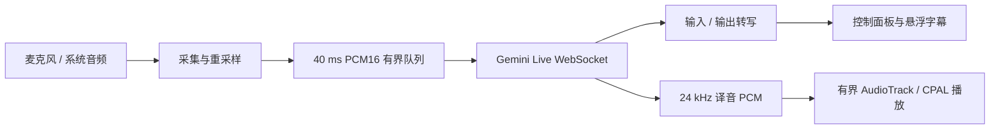

<div align="center">

# Gemini Live Translator

### 面向桌面与 Android 的低延迟实时语音翻译与转写工具

<p>
  <strong>麦克风与系统音频</strong> · <strong>实时双语字幕</strong> · <strong>译音播放</strong> · <strong>系统代理</strong>
</p>

[](package.json)
[](src-tauri)
[](android)
[](android/app/build.gradle.kts)
[](COPYRIGHT)

[功能](#-核心功能) · [平台支持](#-平台支持) · [快速开始](#-快速开始) · [构建](#-开发与构建) · [安全](#-安全与隐私) · [排障](#-常见问题)

</div>

---

> [!WARNING]
> **当前为开发版本，而非已完成真机认证的生产发行版。** CI 已验证构建、单元测试、协议边界和 Java 25 字节码，但 Windows、macOS 与 Android 的真实设备音频、权限、网络和 Gemini 端到端流程仍需继续验证。历史 `0.1.3` Android APK 曾被报告在部分 Android 15+ 设备启动闪退；原生 Kotlin 重写尚不能代替真实设备验证。

## ✨ 核心功能

| 能力 | 说明 |
|---|---|
| 🎙️ **实时音频输入** | 支持麦克风、系统播放音频与混合输入；以 16 kHz 单声道 PCM16、40 ms 帧发送 |
| 🌐 **实时翻译** | 显示原文与译文，可选择播放 Gemini 返回的 24 kHz PCM 译音 |
| 📝 **实时转写** | 仅识别并显示原文，不启动翻译或译音播放链路 |
| 🪟 **悬浮字幕** | 桌面端提供置顶透明字幕窗、鼠标穿透、拖动与 80%–160% 缩放 |
| ⚡ **低延迟管线** | 音频、事件、WebSocket 与播放缓冲全部有界；拥塞时优先保留新鲜音频 |
| 🔇 **静音节省** | 连续近静音约一秒后暂停上传，检测到讲话立即恢复，减少空闲流量与 Token 消耗 |
| 🔐 **敏感信息保护** | Android Keystore；桌面 AES-256-GCM 加密保险库；日志脱敏与敏感内存主动清零 |
| 🛡️ **安全网络** | WSS/TLS 证书与主机名校验，支持系统代理、HTTP CONNECT 与 SOCKS5 |
| 🧭 **连接诊断** | 有界内存诊断控制台，记录阶段、耗时和安全错误类别，不记录音频、字幕或密钥 |

## 🖥️ 平台支持

| 平台 | 技术栈 | 麦克风 | 系统音频 | 当前状态 |
|:---:|---|:---:|:---:|---|
| **Windows 10/11** | Tauri 2 · Rust · WebView2 | ✅ | ✅ WASAPI loopback | 需要 Windows 真机验证、签名与安装升级测试 |
| **macOS 13+** | Tauri 2 · Rust · ScreenCaptureKit | ✅ | ✅ | 需要麦克风和屏幕录制权限；待 Mac 真机与公证验证 |
| **Android 8+** | Kotlin · JDK 25 · Jetpack Compose | ✅ | ✅ Android 10+ | 支持麦克风、手机内声音、混合输入与可拖动系统悬浮字幕；仍待真机验证 |
| **Linux** | Tauri 2 · Rust · ALSA | ✅ | ❌ | 仅作为开发与 CI 辅助平台 |

> [!NOTE]
> Android 是独立的原生工程，不加载 Tauri/WebView，也不链接 Rust/JNI。桌面端继续使用 Tauri + Rust。迁移进度见 [`android/README.md`](android/README.md) 与 [`docs/ANDROID_KOTLIN_MIGRATION.md`](docs/ANDROID_KOTLIN_MIGRATION.md)。

## 🤖 模型模式

| 模式 | 输出 | 适用场景 | 主要限制 |
|---|---|---|---|
| **Gemini 3.8 Live** | 原文、译文、可选译音 | 通用实时译员 | 属于指令式翻译，可能回答或扩写；双向切换依赖模型判断 |
| **Extended Thinking** | 原文、译文、可选译音 | 需要更强推理的翻译 | LOW/MEDIUM/HIGH 可能增加延迟；`turnComplete` 不结束连接 |
| **3.5 Live Translate** | 原文、单一目标语言译文、可选译音 | 固定目标语言翻译 | 不支持双向自动切换；输入已是目标语言时不复述 |
| **3.5 Transcribe Live** | 仅原文 | 逐字或智能整理转写 | 不翻译、不输出译音；单次会话最长约 10 分钟 |

模型、地区、配额与费用取决于 Google 账户和服务可用性。应用不会自动切换模型，也不会通过快速重连规避配额。

## 🚀 快速开始

1. 在 [Google AI Studio](https://aistudio.google.com/api-keys) 创建可访问 Gemini Live 的 API Key。
2. 启动应用，在控制面板填写 Key 并选择模型、目标语言和音源。
3. 如需听取译音，开启「播放翻译语音」并选择输出设备。
4. 点击「开始翻译」或「开始转写」，按系统提示授予必要权限。
5. 桌面端可使用 **F8** 开始或停止；更改模型、语言或音源会重新建立会话。

> [!TIP]
> Windows 系统回录可能同时捕获本应用播放的译音。建议关闭译音，或将译音输出到不参与回录的独立设备。麦克风拾取扬声器时应使用耳机。

### 桌面字幕窗

字幕窗默认置顶并启用鼠标穿透。需要调整位置时：

1. 在控制面板点击「解锁字幕窗以拖动」；
2. 拖动字幕窗上方把手；
3. 点击「锁定并穿透」。

Linux Wayland、全局快捷键冲突或笔记本媒体键可能限制 F8 与鼠标穿透行为。

## 🏗️ 架构



```text
android/                         原生 Kotlin + Compose Android 应用
  app/src/main/java/...          会话、网络、音频、Keystore 与 UI
src/                             桌面控制面板与字幕窗前端
src-tauri/src/
  lib.rs                         会话生命周期、IPC、配置与字幕状态
  gemini_client.rs               Gemini Live WebSocket 协议与 TLS
  audio_router.rs                采集、混音、重采样与 PCM 分帧
  audio_player.rs                译音播放与有界缓冲
  proxy.rs                       系统代理、HTTP CONNECT 与 SOCKS5
  diagnostics.rs                 有界诊断与敏感信息脱敏
  mac_system_audio.rs            macOS ScreenCaptureKit
scripts/                         版本与 Android 构建配置脚本
tests/                           前端、覆盖层、版本和配置测试
docs/                            技术栈与 Android 迁移文档
```

## 🛠️ 开发与构建

### 桌面端

需要 Node.js `^22.22.2` 或 `>=24.15.0`、Rust stable，以及对应平台的 [Tauri 2 前置依赖](https://v2.tauri.app/start/prerequisites/)。

```bash
npm ci
npm run build
npm run test:ui
cargo test --manifest-path src-tauri/Cargo.toml --lib --locked
npm run tauri dev
```

生成当前平台安装包：

```bash
npm run tauri build
```

- **Windows**：需要 Microsoft C++ Build Tools 与 WebView2 Runtime。
- **macOS**：需要 Xcode 和 Command Line Tools，并授予麦克风、屏幕录制／系统音频权限。
- **Ubuntu/Debian**：需要 GTK、WebKitGTK 4.1、ALSA 等 Tauri 平台依赖；Linux 仅用于开发辅助。

### Android

工具链：JDK 25、Gradle 9.9.1、AGP 9.4.1、Kotlin 2.4.21、Android SDK 37。

```bash
export JAVA_HOME=/path/to/jdk-25
export ANDROID_HOME="$HOME/Android/Sdk"
export PATH="$JAVA_HOME/bin:$ANDROID_HOME/platform-tools:$PATH"

gradle -p android testDebugUnitTest assembleDebug
adb install -r android/app/build/outputs/apk/debug/app-debug.apk
```

CI 会检查代表性 Kotlin class 的 class-file major version 为 **69（Java 25）**。当前 APK 使用临时 debug 签名，不能作为应用商店或正式生产包；正式发行必须使用安全保管的独立 release keystore。

### 常用检查

```bash
npm run build
npm run test:ui
npm run test:version
npm run test:android-config
cargo test --manifest-path src-tauri/Cargo.toml --lib --locked
gradle -p android testDebugUnitTest assembleDebug
```

## 🔐 安全与隐私

### API Key 与本地设置

- API Key 只通过 `x-goog-api-key` 请求头发送，不放入 URL、代理 CONNECT 请求或诊断日志。
- 普通偏好写入系统应用私有目录，但 API Key 和手动代理地址不会进入普通 `settings.json`。
- 桌面端可显式启用加密保险库：AES-256-GCM + PBKDF2-HMAC-SHA256（210,000 次、随机盐与 nonce）。密码不会保存，重启后需重新输入。
- Android 使用 Android Keystore 管理 AES-256-GCM 密钥，并启用 `FLAG_SECURE` 限制普通截图。
- 原始 PCM、译音缓冲、API Key 和代理凭据会在可行位置主动清零。

> [!IMPORTANT]
> 本地加密无法抵御已被完全控制、root／越狱、键盘记录或恶意辅助功能攻击的设备。公共客户端若需要更强的密钥防滥用能力，应使用服务端签发的 [ephemeral tokens](https://ai.google.dev/gemini-api/docs/live-api/ephemeral-tokens)，并在服务端实施配额与滥用控制。

### 有界资源

- 输入音频：40 ms／帧，最多约 240 ms 排队预算；拥塞时丢弃旧帧。
- Android WebSocket 待发送预算：32 KiB。
- 网络消息、字幕、播放缓冲、事件流和诊断历史均设置硬上限。
- 诊断历史只保留最近 300 条并驻留内存，退出后清除。
- 服务端原始错误正文、关闭原因、音频和字幕不会写入诊断日志。

## 🌐 代理与 VPN

控制面板支持三种网络模式：

- **自动**：使用操作系统返回的系统代理／PAC 路径或 VPN 路由；
- **手动**：支持 `http://host:port` 与 `socks5://host:port`；
- **系统网络**：不设置显式应用代理，但仍可能经过系统 VPN。

选定路径只表示应用准备使用的路由，**不证明出口地区、VPN 或 Google 服务已经可用**。选中的代理失败后不会静默回退直连。若必须禁止绕过代理，请使用手动代理。

代理凭据可写为 `http://用户名:密码@主机:端口`，特殊字符需进行 URL 百分号编码。HTTP CONNECT 与 SOCKS5 入口本身不加密认证信息，应只连接可信代理并优先使用本机代理。Gemini WSS 在代理隧道内继续执行 TLS 证书与主机名验证；应用不会通过关闭证书校验来兼容 TLS 解密代理。

## 🩺 诊断与排障

连接诊断控制台会显示代理选择、TCP/TLS/WebSocket、`setupComplete`、消息类型、耗时及音频准备阶段。它不会记录 API Key、代理凭据、音频、字幕或服务端原始正文。

遇到问题时：

1. 清空诊断；
2. 重新开始会话并等待错误；
3. 检查日志后再复制分享；
4. 不要发送 API Key、代理密码或未经检查的完整系统报告。

复制的日志会暂时留在系统剪贴板，使用后可用其他文字覆盖。

## ❓ 常见问题

<details>
<summary><strong>连接失败或模型不可用</strong></summary>

检查 API Key、账户模型权限、所在地区、Google 服务状态、代理路径与项目配额。HTTP 429 / `RESOURCE_EXHAUSTED` 表示配额不足，应等待配额窗口恢复。
</details>

<details>
<summary><strong>Android 15+ 安装后立即闪退</strong></summary>

历史 `0.1.3` APK 曾收到此问题报告，但没有可用崩溃堆栈。原生 Kotlin 重写已替换旧运行路径，但尚未在相关真机验证，因此不能声称问题已修复。可从系统开发者选项生成错误报告，只分享经过脱敏且与 `com.gemini.live.translator` 相关的 `FATAL EXCEPTION`、`Caused by`、`Fatal signal` 或 tombstone 片段。
</details>

<details>
<summary><strong>Android 系统音频没有声音</strong></summary>

系统内录要求 Android 10+、本次 MediaProjection 授权、源应用允许 AudioPlaybackCapture、相同用户 profile，且音频用途符合 Android 捕获规则。受保护媒体、通话或明确禁止捕获的应用音频无法绕过限制。
</details>

<details>
<summary><strong>字幕正常但听不到译音</strong></summary>

确认已开启译音、选择了有效输出设备并检查系统音量。关闭译音不会影响字幕。网络拥塞时应用可能丢弃过旧译音以维持实时性。
</details>

<details>
<summary><strong>自动代理没有识别</strong></summary>

确认代理软件设置的是系统代理而非仅浏览器扩展，或确认 VPN 分应用规则包含本应用。PAC 不兼容时可改用手动 HTTP/SOCKS5 地址。手机中的 `127.0.0.1` 指手机自身，不是电脑。
</details>

<details>
<summary><strong>macOS 没有系统音频或透明字幕</strong></summary>

在真正的 `.app` 包中测试，并在「隐私与安全性」中授予麦克风和屏幕录制权限；授权后可能需要重启应用。签名、公证、ScreenCaptureKit 格式及透明窗口仍需目标设备验证。
</details>

## 📦 CI 与发布

- [`.github/workflows/ci.yml`](.github/workflows/ci.yml)：前端构建、UI/版本/配置测试、Rust 测试、原生 Android 单元测试与 APK 构建。
- [`.github/workflows/release.yml`](.github/workflows/release.yml)：构建 Windows x64、macOS Apple Silicon、Linux x64 与原生 Android debug APK。
- [`scripts/set-version.mjs`](scripts/set-version.mjs)：同步 npm、Cargo、Tauri、Android 与 Windows 产物版本。

发布工作流支持 `build_only`、`prerelease` 与 `release`。当前没有代码签名证书或 Android release keystore，因此桌面产物未签名，Android 产物明确为 debug 开发包，不得冒充应用商店或正式生产发行版。

## 📚 文档

- [Android 原生工程说明](android/README.md)
- [Android Kotlin 迁移计划](docs/ANDROID_KOTLIN_MIGRATION.md)
- [技术栈与升级策略](docs/TECH_STACK.md)
- [Gemini Live API](https://ai.google.dev/gemini-api/docs/live-api/get-started-websocket)
- [Gemini Live Translate](https://ai.google.dev/gemini-api/docs/live-api/live-translate)
- [Gemini Live Transcribe](https://ai.google.dev/gemini-api/docs/live-api/live-transcribe)
- [Android AudioPlaybackCapture](https://developer.android.com/media/platform/av-capture)

## ⚖️ 版权

Copyright © 2026 chuyuewei. All rights reserved.

本软件、项目源代码、界面设计、文档及发布产物归项目所有者所有；未经事先书面许可，不得复制、修改、再分发、出售或用于其他商业产品。第三方组件、服务及商标仍归各自权利人所有，并适用各自许可。完整声明见 [`COPYRIGHT`](COPYRIGHT)。
